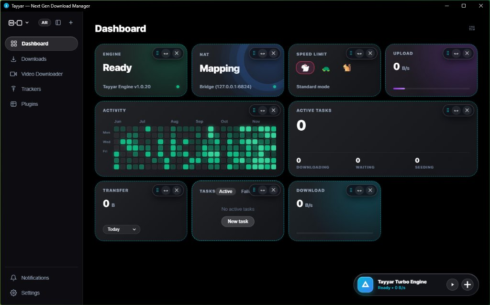
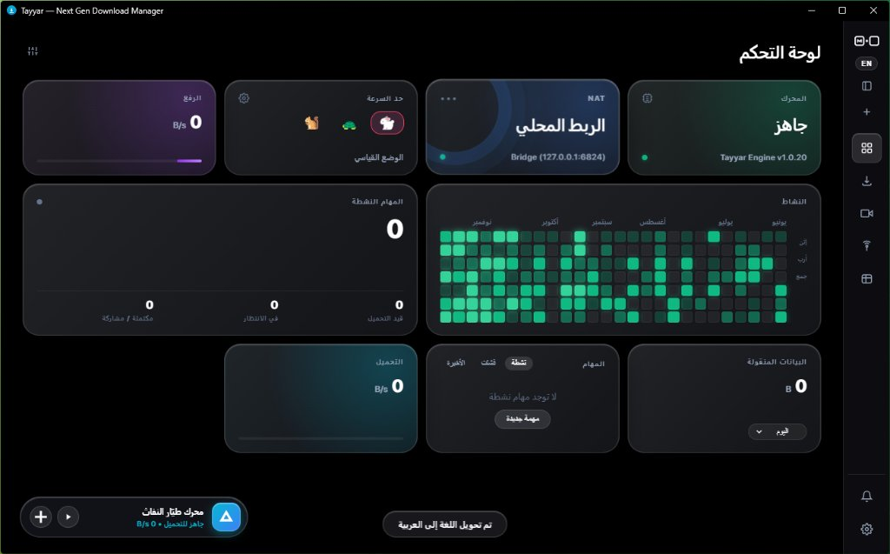
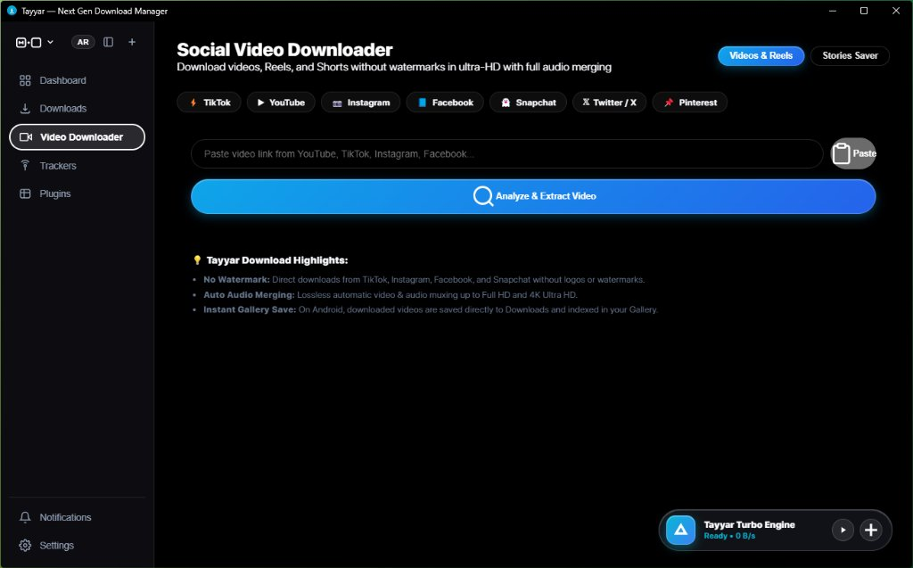
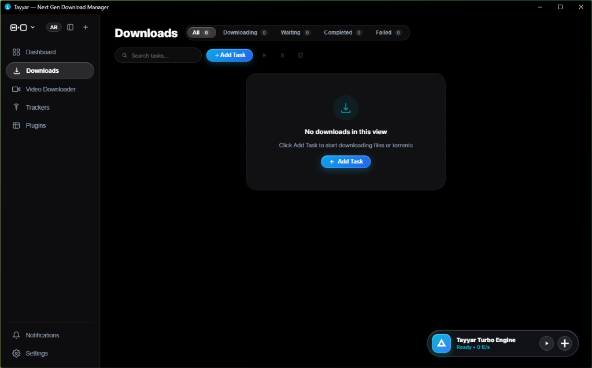
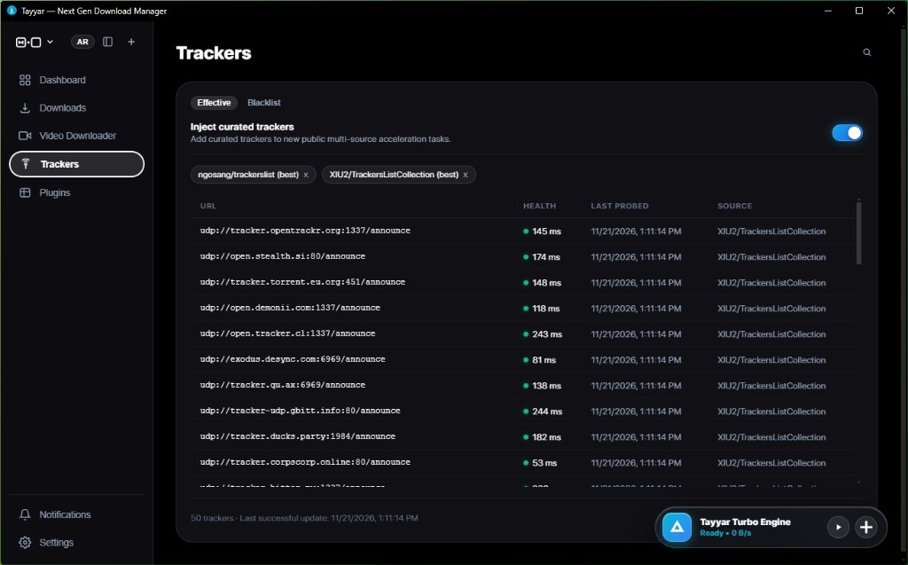
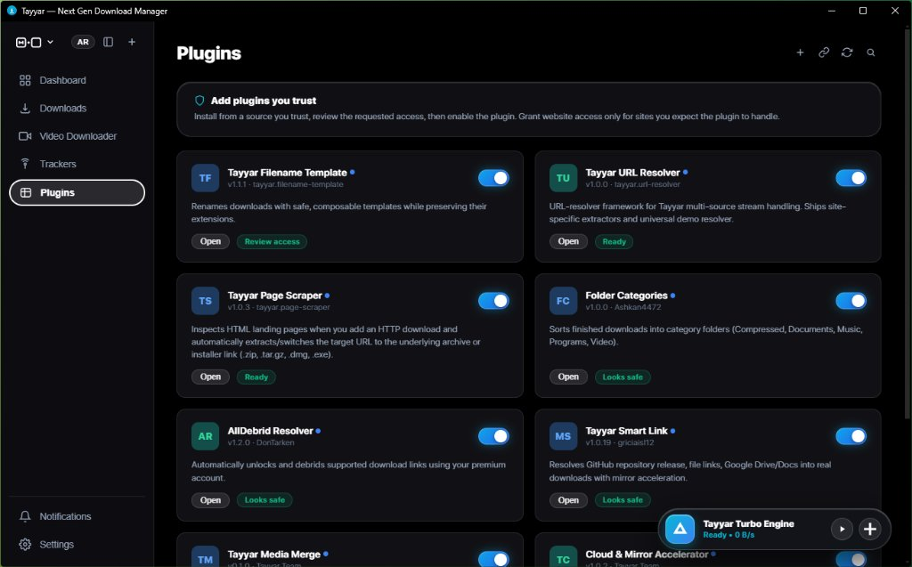
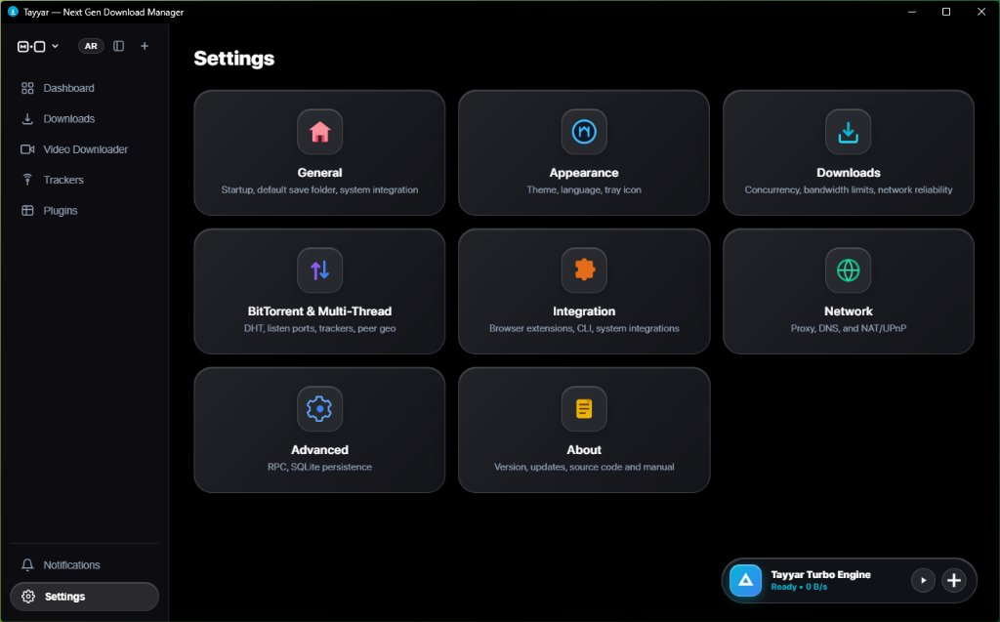
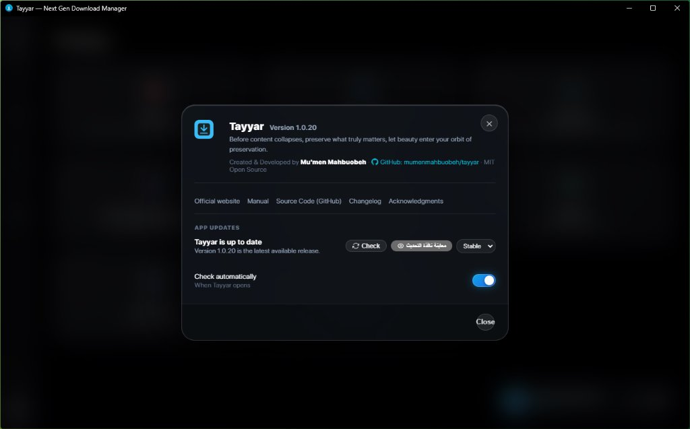
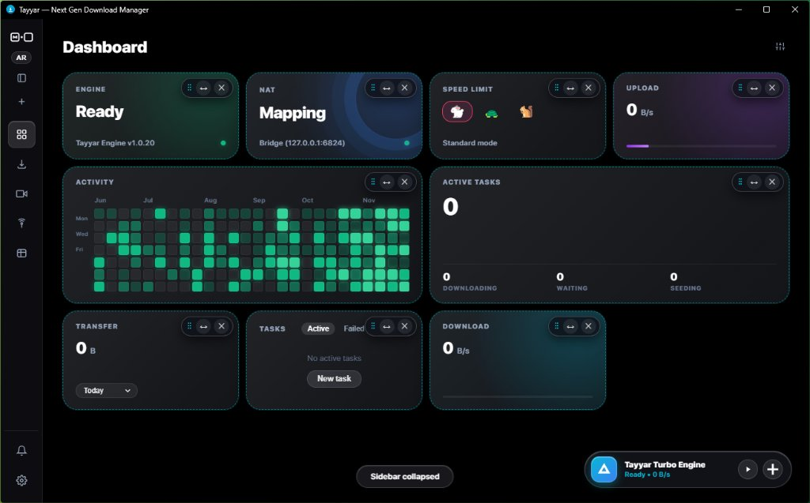
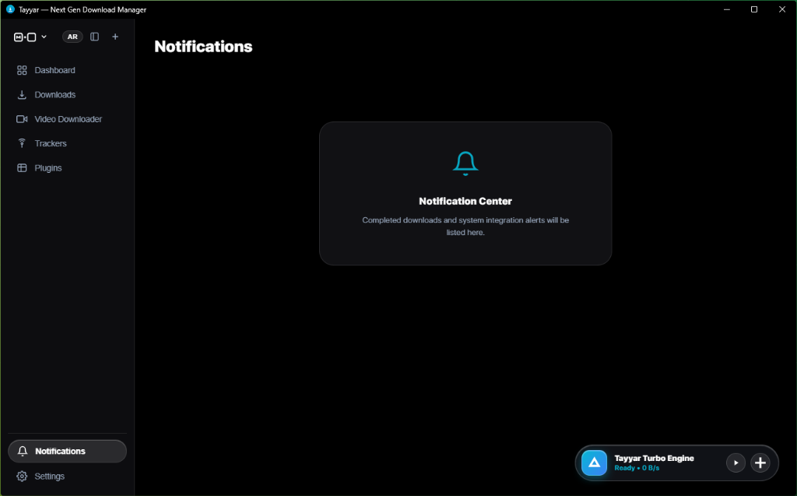

# Tayyar (تيّار) — Next-Gen Multi-Connection Download Manager

<p align="center">
  
</p>

<p align="center">
  <strong>High-Speed, Resilient, Open-Source Universal Download Manager for Desktop & Mobile</strong><br>
  <em>Designed and Developed by <strong>Mu'men Mahbuobeh</strong></em>
</p>

<p align="center">
  <a href="https://github.com/mumenmahbuobeh/tayyar/releases"></a>
  <a href="https://github.com/mumenmahbuobeh/tayyar/actions"></a>
  <a href="LICENSE"></a>
  
  
</p>

---

## 📸 Screenshots & UI Showcase (معرض واجهات طيّار)

> **Modern Dark OLED Aesthetics:** Designed with custom Glassmorphism, real-time telemetry tiles, native English (LTR) / Arabic (RTL) localization, and ultra-smooth responsive layouts.  
> *(Click any image below to view it in full high resolution)*

<div align="center">
  <table>
    <tr>
      <td width="50%" align="center">
        <a href="docs/screenshots/dashboard-en.jpg" target="_blank">
          
        </a>
        <br>
        <sub><b>Modern Bento Dashboard (English LTR)</b><br>Real-time engine status, activity heatmap & download telemetry</sub>
      </td>
      <td width="50%" align="center">
        <a href="docs/screenshots/dashboard-ar.jpg" target="_blank">
          
        </a>
        <br>
        <sub><b>لوحة التحكم بتصميم عربي متكامل (RTL)</b><br>محاذاة كاملة لليمين مع تكامل فوري ومؤشرات حية لكافة العمليات</sub>
      </td>
    </tr>
    <tr>
      <td width="50%" align="center">
        <a href="docs/screenshots/social-video-downloader.jpg" target="_blank">
          
        </a>
        <br>
        <sub><b>Social Video & Stories Extractor</b><br>Direct HD downloads without watermarks (TikTok, IG, YouTube, Facebook, Snapchat)</sub>
      </td>
      <td width="50%" align="center">
        <a href="docs/screenshots/downloads-manager.png" target="_blank">
          
        </a>
        <br>
        <sub><b>Multi-Threaded Downloads Manager</b><br>Category tabs, instant task adding & multi-source bandwidth controls</sub>
      </td>
    </tr>
    <tr>
      <td width="50%" align="center">
        <a href="docs/screenshots/trackers-probing.jpg" target="_blank">
          
        </a>
        <br>
        <sub><b>Real-Time Tracker Health & Probing</b><br>Curated tracker injection, live latency stats & multi-source peering</sub>
      </td>
      <td width="50%" align="center">
        <a href="docs/screenshots/plugins-store.jpg" target="_blank">
          
        </a>
        <br>
        <sub><b>Extensible Plugins Ecosystem</b><br>Smart link resolvers, page scrapers, auto-categorizers & premium debriders</sub>
      </td>
    </tr>
    <tr>
      <td width="50%" align="center">
        <a href="docs/screenshots/settings-grid.jpg" target="_blank">
          
        </a>
        <br>
        <sub><b>Comprehensive Bento Grid Settings</b><br>Fine-tuned network concurrency, RPC persistence & appearance themes</sub>
      </td>
      <td width="50%" align="center">
        <a href="docs/screenshots/about-update-modal.jpg" target="_blank">
          
        </a>
        <br>
        <sub><b>StellarHub-Inspired Update Modal (v1.0.21)</b><br>4-stage stepper pipeline (Download ➜ Check ➜ Install ➜ Reopen) with on-demand preview</sub>
      </td>
    </tr>
    <tr>
      <td width="50%" align="center">
        <a href="docs/screenshots/dashboard-collapsed.jpg" target="_blank">
          
        </a>
        <br>
        <sub><b>Compact Dock & Collapsible Sidebar Mode</b><br>Minimalist 68px icon dock maximizing screen real estate</sub>
      </td>
      <td width="50%" align="center">
        <a href="docs/screenshots/notifications-center.png" target="_blank">
          
        </a>
        <br>
        <sub><b>Unified Notification Center</b><br>Task completion alerts, update announcements & system notifications</sub>
      </td>
    </tr>
  </table>
</div>

---

## 📥 Downloads & Binary Packages (v1.0.21)

Ready-to-use binaries are available on [GitHub Releases v1.0.21](https://github.com/mumenmahbuobeh/tayyar/releases/tag/v1.0.21):

| Platform | Package Format | Direct Download Link | Status |
| :--- | :--- | :--- | :--- |
| **Windows** | `.exe` (Installer) | [📥 Download Tayyar-Setup-1.0.21.exe](https://github.com/mumenmahbuobeh/tayyar/releases/download/v1.0.21/Tayyar-Setup-1.0.21.exe) | ✅ Official Release |
| **Windows** | `.exe` (Portable) | [📥 Download Tayyar-1.0.21.exe](https://github.com/mumenmahbuobeh/tayyar/releases/download/v1.0.21/Tayyar-1.0.21.exe) | ✅ Official Release |
| **Android** | `.apk` (Mobile) | [📱 Download Tayyar-Android-v1.0.21.apk](https://github.com/mumenmahbuobeh/tayyar/releases/download/v1.0.21/Tayyar-Android-v1.0.21.apk) | ✅ Official Release |
| **macOS** | `.dmg` (Universal) | [🍎 Download Tayyar-1.0.21.dmg](https://github.com/mumenmahbuobeh/tayyar/releases/download/v1.0.21/Tayyar-1.0.21.dmg) | ✅ Official Release |
| **Linux** | `.AppImage` | [🐧 Download Tayyar-1.0.21.AppImage](https://github.com/mumenmahbuobeh/tayyar/releases/download/v1.0.21/Tayyar-1.0.21.AppImage) | ✅ Official Release |
| **Linux** | `.deb` (Debian/Ubuntu) | [📦 Download tayyar_1.0.21_amd64.deb](https://github.com/mumenmahbuobeh/tayyar/releases/download/v1.0.21/tayyar_1.0.21_amd64.deb) | ✅ Official Release |
| **Browser Extension** | `.zip` (Chrome, Edge, Brave, Opera) | [🧩 Download Tayyar-Chrome-Extension-v1.0.21.zip](https://github.com/mumenmahbuobeh/tayyar/releases/download/v1.0.21/Tayyar-Chrome-Extension-v1.0.21.zip) | ✅ Ready to Load |
| **Browser Extension** | `.zip` (Mozilla Firefox) | [🦊 Download Tayyar-Firefox-Extension-v1.0.21.zip](https://github.com/mumenmahbuobeh/tayyar/releases/download/v1.0.21/Tayyar-Firefox-Extension-v1.0.21.zip) | ✅ Ready to Load |
| **iOS** | Xcode Project | Build via `npm run build:ios` (Source in `ios/App`) | 🛠️ Source Ready |

---

## ⚡ Highlights & Key Features

### 1. Dynamic Multi-Threaded Chunking (Turbo Engine)
* **Up to 64 Concurrent Connections:** Downloads files in dynamically calculated chunks using HTTP Range requests.
* **Smart End-Game Acceleration:** Automatically sub-divides remaining slow segments across faster idle threads to prevent hanging downloads.
* **Resumable Transfers:** Full session persistence across network dropouts, app restarts, or crashes.

### 2. Social Video Downloader & Stories Saver (v1.0.21)
* **Watermark-Free Downloads:** Direct video extraction from TikTok, Instagram Reels, YouTube Shorts, Facebook, Snapchat, Twitter/X, and Pinterest.
* **Stories Range Selector:** Choose precisely how many stories to download from user profiles with a clean batch range picker.
* **Direct Gallery Saving:** Downloaded media on mobile is directly indexed into the system Gallery under `Movies/Tayyar`.
* **Zero-CORS Native Bridge:** Powered by native network interceptors on Android/iOS and pure Node.js InnerTube extractors on Desktop.

### 3. StellarHub-Inspired Update Experience
* **4-Stage Pipeline Stepper:** Visual stages displaying `Download` ➜ `Check` ➜ `Install` ➜ `Reopen`.
* **Real-time Download Metrics:** Displays downloaded megabytes, speed, and smooth percentage progress bar.
* **On-Demand Preview:** Test and inspect the update window anytime via the **"معاينة / Preview"** button in Settings.

### 4. Universal Support for 200+ File Formats
Tayyar natively identifies, captures, and categorizes over 200 file formats:
* **Documents & E-Books:** `PDF`, `DOCX`, `XLSX`, `PPTX`, `EPUB`, `MOBI`, `AZW3`, `CSV` (with download progress modal & completion alert).
* **Archives & Compressed:** `7Z`, `ZIP`, `RAR`, `TAR`, `GZ`, `BZ2`, `XZ`, `ZST`, `ISO`, `DMG`, `CAB`.
* **Video & Streams:** `MP4`, `MKV`, `AVI`, `WEBM`, `MOV`, `FLV`, `TS`, `M2TS`, `VOB`, `WMV`.
* **Audio & Lossless:** `MP3`, `FLAC`, `WAV`, `AAC`, `OGG`, `M4A`, `OPUS`, `AIFF`.
* **AI & Machine Learning Models:** `GGUF`, `GGML`, `SAFETENSORS`, `CKPT`, `ONNX`, `PT`, `BIN`, `PARQUET`.
* **Applications & Packages:** `EXE`, `MSI`, `APK`, `AAB`, `DEB`, `RPM`, `APPIMAGE`, `DMG`.

### 5. Worldwide Server Resilience
* **Regional CA Resilience:** Transparent handling of servers using sovereign or self-signed TLS certificates (GOST, Iranian national CDNs, Chinese academic repositories).
* **Anti-Hotlinking Spoofing:** Dynamic `User-Agent` and `Referer` spoofing for restricted file hosts (Yandex Disk, Baidu, 1fichier, Rapidgator).
* **Cross-Encoding Resilient Filename Parser:** Seamlessly handles filenames in UTF-8, RFC 5987, Windows-1256 (Arabic), Windows-1251 (Cyrillic), and GBK (Chinese).

### 6. Modern Bilingual Bento Grid UI
* **Bilingual Experience:** Instant toggle between English (`LTR`) and Arabic (`RTL`) with realigned layouts.
* **Collapsible Sidebar:** Toggle between full-width drawer and compact 68px icon dock.
* **Customizable Dashboard:** Real-time speed charts, NAT status, activity heatmap, transfer metrics, and speed limiter presets (Unlimited 🐇, Eco 🐢, Slow 🐌).
* **Built-in Tracker & Plugin Management:** Real-time BitTorrent / acceleration tracker probing with health latency status.

---

## 🛠️ Technology Stack

* **Core Desktop Runtime:** [Electron 33](https://www.electronjs.org/) + Node.js 20
* **Mobile Runtime (Android & iOS):** [Capacitor 7](https://capacitorjs.com/)
* **Engine:** Pure Node.js high-performance asynchronous multi-threaded streams (`http`, `https`, `net`, `crypto`, `fs`)
* **Styling & UI:** Pure Vanilla CSS3 with GPU-accelerated Glassmorphism (zero heavy framework overhead)
* **Packaging:** `electron-builder` + Gradle / Android Studio toolchain

---

## 🚀 Development & Build Instructions

### Prerequisites
* [Node.js](https://nodejs.org/) v20+
* [npm](https://www.npmjs.com/) v10+
* (For Android APK builds) Java JDK 21 & Android SDK 35

### 1. Clone & Install
```bash
git clone https://github.com/mumenmahbuobeh/tayyar.git
cd tayyar
npm install
```

### 2. Run in Development Mode
```bash
npm start
```

### 3. Run Self-Test Suite
```bash
npm test
```

### 4. Build Desktop Packages
```bash
# Windows (.exe installer & portable binary)
npm run dist:win

# Linux (.AppImage & .deb packages)
npm run dist:linux

# macOS (.dmg disk image)
npm run dist:mac
```

### 5. Build Android APK
```bash
# Sync web renderer with Android project
npm run build:android

# Build debug APK with Gradle
cd android
./gradlew assembleDebug

# Output APK path:
# android/app/build/outputs/apk/debug/app-debug.apk
```

---

## 📱 Mobile Architecture (Android)

Tayyar's responsive UI adapts smoothly to mobile screens via Capacitor. To open and inspect the native Android project in Android Studio:
```bash
npm run open:android
```

---

## 👨‍💻 Author & Attribution

* **Author & Lead Developer:** **Mu'men Mahbuobeh**
* **GitHub Profile:** [@mumenmahbuobeh](https://github.com/mumenmahbuobeh)
* **Repository:** [https://github.com/mumenmahbuobeh/tayyar](https://github.com/mumenmahbuobeh/tayyar)

---

## 📄 License

This project is licensed under the **MIT License** — feel free to use, modify, distribute, and contribute.  
See the [LICENSE](LICENSE) file for complete details.
